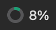
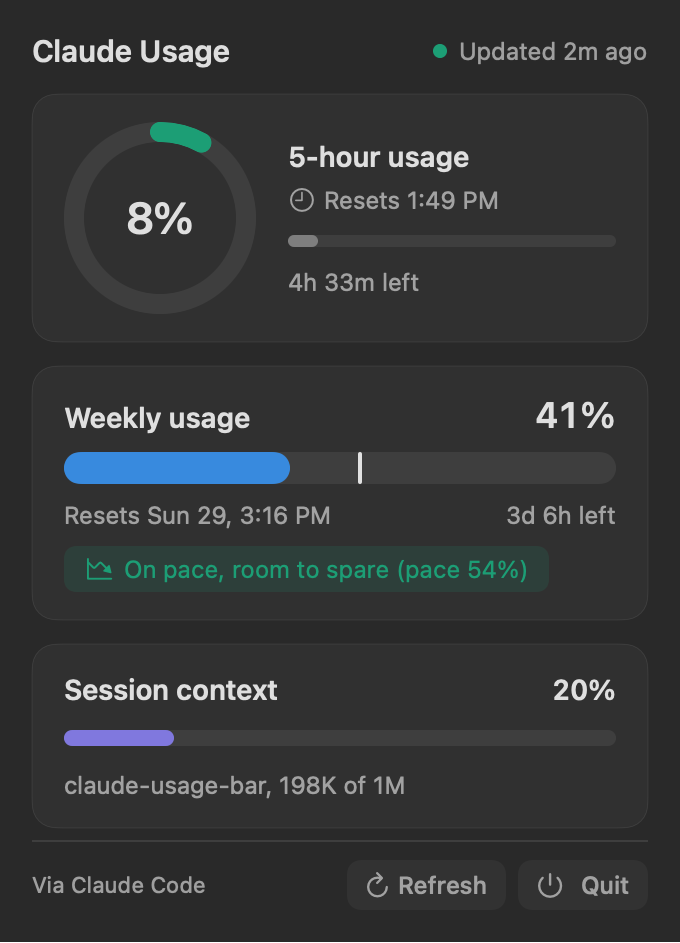

<p align="center">
  
</p>

<h1 align="center">Claude Usage Bar</h1>

<p align="center">
  <b>English</b> | <a href="README.ko.md">한국어</a>
</p>

An open source macOS menu bar app that shows your Claude plan usage as rings and bars.

A ring for your 5-hour usage sits in the menu bar. Click it to open cards for your 5-hour usage, your weekly usage, and the current session's context window.

The app follows your Mac's language: Korean if Korean is your first preferred language, English otherwise.

## Screenshots

| Menu bar (normal) | Menu bar (80% or more) |
|---|---|
|  |  |

<p align="center">
  
</p>

- **Menu bar:** a ring and the percentage for your 5-hour usage. Green below 80%, orange from 80%. A dashed gray ring means there is no value yet, and the ring dims when nothing has updated for 30 minutes.
- **Panel:**
  - 5-hour usage: a large ring, the reset time, a bar for how much of the 5 hours has passed, and the time left
  - Weekly usage: a bar with a pace marker. The marker shows where you would be if you spread your usage evenly over the week. Below it, a badge says whether you have room to spare or will run out before the reset at this pace
  - Current session context: the context window use of the session that got the latest response
  - Refresh and Quit buttons

## How it works

This repository has two parts that work together. **Install both to see values.**

- **The menu bar app (`menubar/`, SwiftUI):** reads the usage file and draws it.
- **The mod `usage-bar-for-claude` (a Claude Code plugin):** whenever Claude Code reports new usage, it writes the 5-hour and weekly usage, their reset times, and the current session's context use to `~/.claude/claude-usage-bar.json`. It also shows a toast inside Claude Code the first time a window crosses 80%, in Korean or English to match your locale.

## Requirements

| Item | Version |
|---|---|
| macOS | 14 (Sonoma) or later. Intel and Apple silicon Macs |
| Claude Code | A version with mod support. Tested on **2.1.332**. Mods are still evolving, so later versions may behave differently |
| Claude plan | A subscription plan with usage limits. With an API key, no usage values arrive, so the panel keeps saying it will show values after the next response |

## Install

### 1. Download the menu bar app

1. Download `ClaudeUsageBar-<version>.zip` from the [Releases](https://github.com/2giwon/claude-usage-bar/releases/latest) page.
2. Unzip it and move `Claude Usage Bar.app` to your `Applications` folder.
3. Open the app. **The app is not signed, so macOS blocks it the first time.** Go to System Settings > Privacy & Security, find the note that "Claude Usage Bar" was blocked, and click **Open Anyway**. You only need to do this once.

A dashed gray ring in the menu bar means the app is running. Install the mod below and get one response in Claude Code to fill it in.

### 2. The mod

At the prompt of a terminal Claude Code session:

```
/plugin install usage-bar-for-claude --marketplace 2giwon/claude-usage-bar
```

Answer `y` to add the marketplace, then pick the user scope so the mod runs in every session.

From a shell:

```bash
claude plugin install usage-bar-for-claude --marketplace 2giwon/claude-usage-bar
```

In the desktop app, where `/plugin` does not run: click + next to the prompt box, then Plugins, Add marketplace with `2giwon/claude-usage-bar`, then Add plugin.

After installing, run `/reload-plugins` in any session that is already open.

### 3. Session board (optional)

The popover can also list your Claude desktop app (Code tab) sessions: which one is working, which one needs you, which one is done. Click a row to jump to that session in the desktop app. If a session waits for you for more than 10 minutes, you get one macOS notification.

It runs on Claude Code hooks. Add these to `~/.claude/settings.json` (merge them into your existing `"hooks"` if you have any). The path assumes the app is in `/Applications`; change it if you put the app somewhere else.

```json
{
  "hooks": {
    "UserPromptSubmit": [{ "hooks": [{ "type": "command", "command": "B=\"/Applications/Claude Usage Bar.app/Contents/MacOS/ClaudeUsageBar\"; [ -x \"$B\" ] && \"$B\" --session-hook || cat > /dev/null; exit 0", "timeout": 5 }] }],
    "Stop": [{ "hooks": [{ "type": "command", "command": "B=\"/Applications/Claude Usage Bar.app/Contents/MacOS/ClaudeUsageBar\"; [ -x \"$B\" ] && \"$B\" --session-hook || cat > /dev/null; exit 0", "timeout": 5 }] }],
    "SessionEnd": [{ "hooks": [{ "type": "command", "command": "B=\"/Applications/Claude Usage Bar.app/Contents/MacOS/ClaudeUsageBar\"; [ -x \"$B\" ] && \"$B\" --session-hook || cat > /dev/null; exit 0", "timeout": 5 }] }],
    "Notification": [{ "matcher": "permission_prompt|elicitation_dialog", "hooks": [{ "type": "command", "command": "B=\"/Applications/Claude Usage Bar.app/Contents/MacOS/ClaudeUsageBar\"; [ -x \"$B\" ] && \"$B\" --session-hook || cat > /dev/null; exit 0", "timeout": 5 }] }],
    "PreToolUse": [{ "matcher": "*", "hooks": [{ "type": "command", "command": "B=\"/Applications/Claude Usage Bar.app/Contents/MacOS/ClaudeUsageBar\"; [ -x \"$B\" ] && \"$B\" --session-hook || cat > /dev/null; exit 0", "timeout": 5 }] }],
    "PostToolUse": [{ "matcher": "AskUserQuestion", "hooks": [{ "type": "command", "command": "B=\"/Applications/Claude Usage Bar.app/Contents/MacOS/ClaudeUsageBar\"; [ -x \"$B\" ] && \"$B\" --session-hook || cat > /dev/null; exit 0", "timeout": 5 }] }]
  }
}
```

- The `PreToolUse` hook runs before every tool call (about 30 ms each) so each row can say what Claude is doing: reading, editing, running a command, looking things up, delegating or planning. A session with no sign of life for 30 minutes is shown as done.
- To mirror the list somewhere else (a web page of your own), create `~/.claude/claude-usage-bar-board.json` with `{ "url": "https://…", "key": "…" }`. The app then POSTs `{ "rows": [...] }` there with `Authorization: Bearer <key>` whenever the list changes, and once a minute. Titles go with it, folder paths do not. Without that file nothing is sent anywhere.
- The hooks write one small file per session to `~/.claude/session-board/`. The Sessions card shows up once that folder exists, so nothing changes if you skip this step.
- Session titles and the "jump to session" link come from the desktop app's own session files (`~/Library/Application Support/Claude/claude-code-sessions/`) and its `claude://code/continue?session=…` link. **Neither is documented by Anthropic**, so a desktop app update may break them. When the app can't read a title, it shows the folder name and says so.
- A session in the terminal (not the desktop app) has no desktop session to open, so it is not listed.

### Build from source

With Swift 5.10 or later (Xcode, or the Command Line Tools: `xcode-select --install`):

```bash
git clone https://github.com/2giwon/claude-usage-bar.git
cd claude-usage-bar/menubar
make install
```

This builds `Claude Usage Bar.app`, copies it to `~/Applications`, and opens it. To start it when you log in:

```bash
make login
```

`make unlogin` undoes that, and `make uninstall` removes the app.

## Good to know

- The values are the ones Claude Code already reports, copied to a file. Nothing reads your credentials, and nothing sends extra requests to measure usage.
- The file is written only when a Claude Code session gets a response that changes your usage. While you are not using Claude Code, the last values stay, and the panel says how old they are. Once a reset time passes, that window shows as reset until the next response brings a new value.
- Per-model weekly limits are not shown. Claude Code gives mods only the 5-hour window and the all-models weekly window.

## Development

```bash
claude plugin test .              # mod tests
claude plugin validate .          # mod checks
cd menubar && make check          # app calculation checks (Swift Testing needs Xcode, so these run as a small program)
cd menubar && swift run ClaudeUsageBar --render /tmp/claude-usage-bar   # save each state of the panel as PNG
cd menubar && make icon           # rebuild the app icon (AppIcon.icns)
```

Push a version tag such as `v0.2.0` and GitHub Actions builds the app and attaches a zip to Releases (`.github/workflows/release.yml`).

## License

MIT. See [LICENSE](LICENSE).
