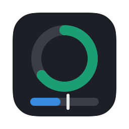
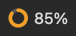
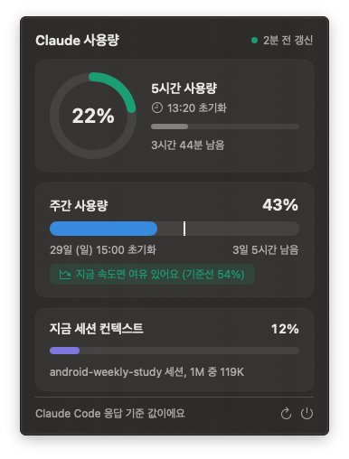

<p align="center">
  
</p>

<h1 align="center">Claude Usage Bar</h1>

> A macOS menu bar app (plus a small Claude Code mod) that shows your Claude plan usage, 5-hour and weekly, as rings and bars. The app's UI is in Korean.

Claude 요금제 사용량을 맥 메뉴 막대에 그래픽으로 보여 주는 오픈소스 도구예요.

메뉴 막대에는 5시간 사용량 링이 떠 있고, 누르면 5시간 사용량, 주간 사용량, 지금 세션의 컨텍스트 사용률을 카드로 펼쳐 보여 줘요.

## 화면

| 메뉴 막대 (평소) | 메뉴 막대 (80% 이상) |
|---|---|
|  |  |

<p align="center">
  
</p>

- **메뉴 막대:** 5시간 사용량 링과 숫자. 80% 미만은 초록, 80% 이상은 주황이에요. 값이 아직 없으면 점선 회색 링이고, 30분 넘게 갱신이 없으면 흐리게 보여요.
- **펼침 화면:**
  - 5시간 사용량: 큰 링, 초기화 시각, 5시간 중 지난 시간 막대, 남은 시간
  - 주간 사용량: 막대와 기준선. 기준선은 일주일을 고르게 썼다면 지금쯤 몇 %여야 하는지를 표시해요. 기준선보다 적게 썼으면 "여유 있어요", 많이 썼으면 "이 속도면 초기화 전에 다 써요"로 알려 줘요
  - 지금 세션 컨텍스트: 마지막으로 응답을 받은 세션의 컨텍스트 사용률

## 구성

이 저장소는 함께 동작하는 두 부분으로 되어 있어요. **둘 다 설치해야 값이 나와요.**

- **메뉴 막대 앱 (`menubar/` 폴더, SwiftUI):** 사용량 파일을 읽어서 그려요.
- **mod `usage-bar-for-claude` (Claude Code 플러그인):** Claude Code가 새 사용량을 알려 줄 때마다 5시간 사용량, 주간 사용량, 각 초기화 시각, 지금 세션의 컨텍스트 사용률을 `~/.claude/claude-usage-bar.json`에 써요. 사용량이 80%를 처음 넘으면 Claude Code 안에 알림도 띄워요.

## 필요한 것

| 항목 | 버전 |
|---|---|
| macOS | 14 (Sonoma) 이상. Intel 맥과 Apple 실리콘 맥 모두 돼요 |
| Claude Code | mod 기능이 있는 버전. **2.1.332**에서 확인했어요. mod 기능은 아직 바뀔 수 있어서, 이후 버전에서 동작이 달라질 수 있어요 |
| Claude 요금제 | 사용량 한도가 있는 구독 요금제. API 키로 쓰면 "구독 요금제 사용량이 없어요"가 나와요 |

## 설치

### 1. 메뉴 막대 앱 내려받기

1. [Releases](https://github.com/2giwon/claude-usage-bar/releases/latest) 페이지에서 `ClaudeUsageBar-버전.zip`을 내려받아요.
2. 압축을 풀고 `Claude Usage Bar.app`을 `응용 프로그램` 폴더로 옮겨요.
3. 앱을 열어요. **서명하지 않은 앱이라 처음에는 macOS가 열지 못하게 막아요.** 그러면 시스템 설정 > 개인정보 보호 및 보안으로 가서, 아래쪽의 "Claude Usage Bar"가 차단되었다는 안내 옆 **그래도 열기**를 누르세요. 한 번만 하면 돼요.

메뉴 막대에 점선 회색 링이 보이면 앱이 켜진 거예요. 아래 mod를 설치하고 Claude Code에서 응답을 한 번 받으면 값이 채워져요.

### 2. mod

터미널의 Claude Code 입력창에서:

```
/plugin install usage-bar-for-claude --marketplace 2giwon/claude-usage-bar
```

마켓플레이스를 추가할지 물으면 `y`, 범위는 user를 고르면 모든 세션에서 동작해요.

셸에서 설치할 때:

```bash
claude plugin install usage-bar-for-claude --marketplace 2giwon/claude-usage-bar
```

데스크톱 앱에서는 `/plugin`이 동작하지 않아요. 입력창 옆 + 버튼, Plugins, Add marketplace에 `2giwon/claude-usage-bar`를 넣고 Add plugin을 누르세요.

설치한 뒤 열려 있는 세션에서는 `/reload-plugins`를 실행하세요.

### 소스에서 직접 빌드하기

Swift 5.10 이상(Xcode나 명령줄 도구 `xcode-select --install`)이 있으면 직접 빌드할 수 있어요.

```bash
git clone https://github.com/2giwon/claude-usage-bar.git
cd claude-usage-bar/menubar
make install
```

`Claude Usage Bar.app`을 빌드해서 `~/Applications`에 넣고 실행해요. 로그인할 때 자동으로 켜지게 하려면:

```bash
make login
```

`make unlogin`은 자동 실행을 끄고, `make uninstall`은 앱을 지워요.

## 알아 두실 점

- 값은 Claude Code가 이미 알려 준 값을 파일로 옮긴 거예요. 로그인 정보를 읽지 않고, 사용량을 재려고 따로 요청을 보내지도 않아요.
- 값은 Claude Code 세션이 응답을 받을 때만 새로 써져요. Claude Code를 쓰지 않는 동안에는 마지막 값이 보이고, 펼침 화면에 몇 분 전 값인지 나와요. 초기화 시각이 지나면 그 사용량은 "초기화됨"으로 바뀌고 다음 응답 때 새 값이 들어와요.
- 모델별 주간 사용량(예: 특정 모델 전용 주간 한도)은 보여 주지 않아요. Claude Code가 mod에 주는 값은 5시간 사용량과 모든 모델 합계 주간 사용량뿐이에요.

## 개발

```bash
claude plugin test .              # mod 테스트
claude plugin validate .          # mod 검사
cd menubar && make check          # 앱 계산 함수 검사 (Swift Testing은 Xcode가 있어야 빌드돼서, 작은 실행 파일로 검사해요)
cd menubar && swift run ClaudeUsageBar --render /tmp/claude-usage-bar   # 펼침 화면을 상태별 PNG로 저장
cd menubar && make icon           # 앱 아이콘(AppIcon.icns) 다시 만들기
```

`v0.2.0` 같은 버전 태그를 올리면 GitHub Actions가 앱을 빌드해서 Releases에 zip으로 올려요(`.github/workflows/release.yml`).

## 라이선스

MIT. [LICENSE](LICENSE) 파일을 보세요.
